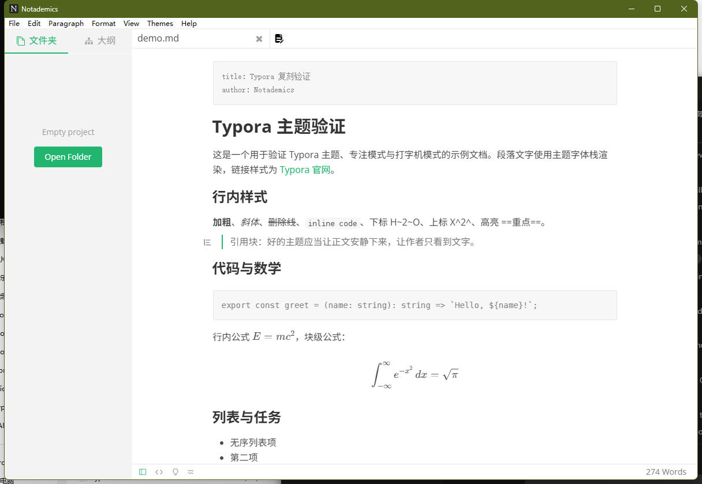
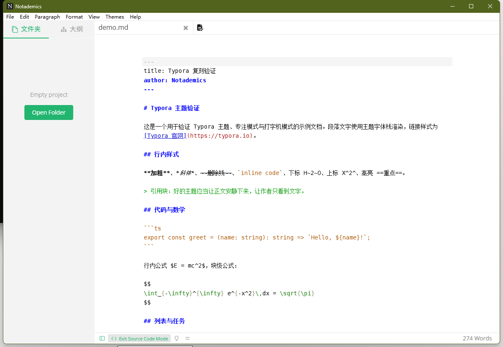

# Typora replication on Notademics (Tauri + React + Muya)

This document records how the Typora look and behaviour was reconstructed inside
Notademics, which evidence each decision rests on, and what remains unverified.
A longer evidence ledger (`typora-rea-report.md`, produced during the analysis)
is kept in the local working tree only: it describes licensing modifications in
the installed Typora copy and is therefore not published with this repository.

## Target identity

| Fact | Value | Evidence |
| --- | --- | --- |
| Product | Typora for Windows | `D:\Project\Typora\Typora\Typora.exe` |
| Version | 1.14.9 (build 42.2.0, release id `be82b3a0`) | `resources/package.json`, `version` |
| Renderer surface | readable SystemJS bundle | `resources/appsrc/window/frame.js` (~1.7 MB) |
| Localisation / menu text | JSON string tables | `resources/locales/Base.lproj/{Menu,Panel}.json` |
| Shell markup | full DOM skeleton | `resources/window.html` |
| Bundled themes | github, night, newsprint, pixyll, whitey | `resources/style/themes/*.css` |

The analysis is **static**: no Typora process was instrumented, so runtime-only
behaviour (exact timing, native IPC side effects) is marked as unknown rather
than asserted.

## Method

1. Route the target: an installed Electron application with extracted
   `resources/`, so the JavaScript-application route applies instead of the
   native-binary route.
2. Build the smallest inventory that answers the question: renderer bundle,
   locale tables, shell HTML, theme CSS, preference bundles.
3. Trace from the entry points Typora itself documents in markup: footer
   control ids, menu strings, theme loader (`setting.getThemes`), preference
   panel webview.
4. Corroborate layout claims with a second evidence type: the shell markup in
   `window.html` plus the CSS that targets the same ids.
5. Port, then verify in the rebuilt application (typecheck, Rust check, release
   build, screenshot).

REA's `analyze-javascript-application` command was run against
`resources/appsrc` for the application-graph evidence; the result bundle lives in
`D:\Project\_rea\` (summary + 54 MB evidence graph). Observed coverage for that
run: 3 JavaScript sources, 1,773,557 text bytes parsed, 503,464 AST nodes,
1,992 findings, 720/720 inventoried items examined, 0 parse failures. The run
reached its semantic retention budgets (20,000 nodes/unknowns per file), so
`graph.coverage.status` is `partial`; REA reports 20 explicit limitations and
20,641 unresolved semantic unknowns rather than claiming completeness.
Craft Anything's tool vocabulary (target triage → feature trace → evidence
ledger) shaped the same staged investigation. Its CLI (0.6.1, portable build)
was then run against the same `resources` tree with `js_app_map` in deep mode:

> `Electron app resources 1.14.9: 37 source files, 12 IPC channel(s) (0 paired),
> 0 window(s), 17 endpoint(s), 1 route(s), bundled with browserify/tsc.`

Craft Anything examined 218 of 641 inventoried items (`coverage.status =
partial`) and, like REA, reports the limits of its static view instead of
claiming completeness. Its first run was refused in Clean room because it would
read the target's code; the successful run used `--deep`.

## What was ported

### 1. Typora's five bundled themes

`app/src/styles/marktext/themes/typora-{github,night,newsprint,pixyll,whitey}.theme.css`

Typora applies a theme as one stylesheet over `#write`; Notademics applies a
theme as CSS-variable overrides plus editor rules over `.mu-container`. The
ported files therefore carry two layers:

- a `:root` block that maps the Typora palette onto the app's existing chrome
  variables (`--themeColor`, `--editorColor*`, `--sideBar*`, `--code*`,
  `--linkColor`, `--blockquote*`, `--tableBorderColor`, …), so sidebar, footer,
  menus and floats match the document instead of staying on the old palette;
- the theme's typography/layout rules, with `#write` remapped to
  `.mu-container`, `body`/`html` font settings remapped to `.mu-editor`, and
  remote font imports dropped in favour of system stacks.

`typora-github` is now the default theme, with `typora-night` as the default
dark/system theme, matching Typora's own default (`github`, dark counterpart
`night`).

### 2. Typora-style footer

`app/src/components/statusBar/index.tsx` + `app/src/styles/marktext/statusBar.css`

Typora's footer (`#outline-btn`, `#toggle-sourceview-btn`,
`#toggle-focus-mode-btn`, `#toggle-typewriter-mode-btn`, `#footer-word-count`)
is reproduced as:

- left: sidebar toggle, source-code mode toggle (with Typora's
  "Exit Source Code Mode" label while active), focus mode, typewriter mode,
  read-only mode;
- right: `N Words` label with the hover popover from Typora's
  `#footer-word-count-info` — reading time (382 wpm), lines, words, characters,
  selection counts, encoding and save state.

### 3. Writing modes

- **Source Code Mode** — existing CodeMirror pane, now reachable from
  `Ctrl+/` exactly like Typora (menu accelerator), with the footer toggle.
- **Focus Mode** — Muya's native focus mode (`setFocusMode`), reachable from
  `F8` and the footer; non-active blocks dim, the active block stays crisp.
- **Typewriter Mode** — existing caret-centring scroll, reachable from `F9`.
- **Readonly Mode** — keeps the rendered page but sets the Muya writing surface
  non-editable (`contenteditable="false"` + `.mu-readonly`). Typora exposes this
  mode from the menu only (no footer button, no accelerator), and so does this
  port.

Because Muya reads mode options only at construction, `MuyaEditor` now exposes
`setFocusMode`/`setReadOnly` imperative methods and `editor.tsx` keeps them in
sync with the preference store.

### 4. Menu structure

`app/src-tauri/src/menu.rs` was reshaped to Typora's Windows menu bar:

- **File** — New, New Window, Open…, Open Folder…, Save, Save As…, Auto Save,
  Move To, Rename, Import, Preferences…, Close Tab, Close Window, Quit.
- **Edit** — Typora wording for copy/paste variants ("Copy as Markdown",
  "Copy as HTML Code", "Paste as Plain Text") plus find/replace and line
  endings.
- **Paragraph** — Heading 1–6, Paragraph, Increase/Decrease Heading Level,
  Table, Code Fences, Math Block, Quote, HTML Block, Ordered/Unordered/Task
  list, Loose List Item, Horizontal Line, YAML Front Matter.
- **Format** — Strong, Emphasis, Underline, Code, Inline Math, Strike,
  Highlight, Superscript, Subscript, Hyperlink, Image, Clear Format.
- **View** — Source Code Mode (`Ctrl+/`), Focus Mode (`F8`), Typewriter Mode
  (`F9`), Readonly Mode, Toggle Sidebar (`Ctrl+Shift+L`), Outline
  (`Ctrl+Shift+1`), Status Bar, Zoom In/Out, Full Screen, Command Palette,
  Developer Tools, Reload.
- **Themes** — a `Typora Themes` group (GitHub, Night, Newsprint, Pixyll,
  Whitey) followed by the existing light/dark theme groups.
- **Help** — as before.

Typora's Windows build has no `Window` menu (the bytecode menu template lists
`File / Edit / Paragraph / Format / View / Themes / Help`); the old Notademics
`Window` menu was dropped to match, and its commands remain available through
the command palette.

Every menu id maps to an existing command in `app/src/commands/index.ts`;
`view.focus-mode`, `view.typewriter-mode`, `view.readonly-mode` and
`view.toggle-status-bar` were added there and in the en/zh-CN string tables.

### 5. Defaults

- default theme `typora-github`, dark/system counterpart `typora-night`;
- footer visible by default, persisted (`status-bar-visible`);
- Typora's word-count/read-time model (382 wpm) instead of MarkText's cycling
  `W/C/P/A` counter.

### 6. Shell / "Open with" launch

Typora documents opening `typora file.md` from cmd/PowerShell and registers
file associations. Notademics already registered `.md` association, but a cold
start dropped the path and a second instance only activated the window. Now:

- the backend collects existing file arguments at setup (`cli_files.rs`) and
  exposes them through the `get_cli_files` command;
- the renderer opens the first path after its listeners are ready;
- the single-instance `open-file` event is now handled by the renderer.

This is also what makes the verification screenshot show a real document.

## Architecture mapping

| Typora | This implementation |
| --- | --- |
| `#write` | `.mu-container` (Muya) |
| `frame.js` mode toggles | `preferences` store (`focus`, `typewriter`, `sourceCode`, `readonly`) |
| `#footer-word-count` | `StatusBar` word-count popover |
| theme CSS applied to `#write` | theme CSS injected into `#ag-theme` `<style>` (`util/theme.ts`) |
| `setting.getThemes` | `styles/marktext/themes/*` + `util/themeColor.ts` |
| native menu bar | Tauri native menu (`src-tauri/src/menu.rs`) |

## Verification

What was actually run on this machine (Windows, 2026-11-15):

| Check | Command / method | Result |
| --- | --- | --- |
| Frontend typecheck + build | `npm run build` (`tsc --noEmit` + `vite build`) | pass |
| Rust backend | `cargo check` | pass (1 pre-existing unused-dependency warning) |
| Debug binary | `cargo build` then launch | runs, opens `demo.md` from the command line |
| Theme CSS validity | PostCSS parse of all five files (agent-side) | pass, 0 parse errors |
| Typora GitHub rendering | screenshot, heading/quote/code/math/front-matter | matches the ported theme |
| Footer word count | screenshot, `274 Words` for the demo document | pass |
| Focus Mode | `F8` / footer toggle, blocks dim except the caret block | pass |
| Source Code Mode | `Ctrl+/` / footer toggle, CodeMirror pane + "Exit Source Code Mode" label | pass |
| Theme defaults | `typora-github` selected on first run | pass |

Screenshots (cropped to the application window):






Not verified in this pass: night/newsprint/pixyll/whitey screenshots (their CSS
was parse- and presence-checked, and the same registration path is used),
release/MSI packaging (`npx tauri build`), typing/keyboard shortcuts other than
`F8` and `Ctrl+/`, and any Typora runtime observation.

## Known deviations

- Typora opens each document in its own window and has no tab bar; Notademics
  keeps its tab bar because documents are opened as tabs. It can be hidden from
  the View menu in the MarkText-derived UI.
- Export (HTML/PDF/EPUB via Pandoc), spell-check language downloads, image
  uploaders, and the licence/update surface are out of scope for this pass.
- Typora's frameless/unibody title bar is not reproduced; the app keeps the
  native Windows frame and native menu.
- The footer's "In Selection" numbers read the live DOM selection; Typora reads
  its own selection model, so edge cases around atomic inline nodes can differ.
- Exact accelerator wiring beyond the ones listed in the menu is not claimed.

## Build and run

```powershell
cd D:\Project\Notademics-Windows\app
npm install
npm run build            # tsc --noEmit + vite build
cd src-tauri
cargo check
```

`cargo build` produces `target/debug/notademics.exe`, but a debug binary is
built against `devUrl`, so run the Vite dev server (`npm run dev`) before
launching it. For a self-contained executable with the frontend embedded, run:

```powershell
cd D:\Project\Notademics-Windows\app
npx tauri build --no-bundle   # release exe with embedded dist
```

(Tauri's test harness used the debug binary + `npm run dev` for the screenshots
above.)
